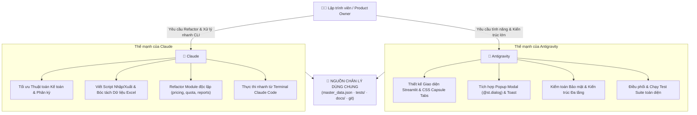

# QUY TRÌNH PHỐI HỢP ĐA AGENT: CLAUDE 🤝 ANTIGRAVITY
**Dự án: I-Cost — Nền tảng Quản trị & Lập Ngân Sách Đầu Tư CNTT (Tập đoàn Đại Dũng)**

---

## 1. Mục Tiêu & Triết Lý Phối Hợp

Hệ thống I-Cost được phát triển với sự hỗ trợ của hai trợ lý AI hàng đầu:
* **Antigravity** (Google DeepMind): Chuyên sâu về kiến trúc hệ thống, Generative UI, Design System doanh nghiệp, kiểm toán bảo mật và kiểm thử tự động.
* **Claude** (Anthropic Claude Code / Desktop): Chuyên sâu về phân tích logic, refactoring dòng lệnh, xử lý dữ liệu thuật toán và tinh chỉnh nhanh từ terminal.

Mục tiêu của quy trình này là biến hai trợ lý thành một **cặp đôi lập trình (Pair-Programming Duo)** ăn ý, sử dụng chung một "nguồn chân lý" (Single Source of Truth), không giẫm chân lên nhau và duy trì độ ổn định tuyệt đối cho hệ thống.

---

## 2. Phân Chia Vai Trò Đề Xuất (Division of Labor)



---

## 3. Bốn Quy Tắc Kỹ Thuật Bất Biến (Golden Rules)

### Quy tắc 1: Phân bổ Cổng Mạng Tránh Xung Đột (Port Allocation)
* **Cổng `8501`**: Dành cho môi trường chạy chính thức của Antigravity và người dùng mở qua `run_app.bat`.
* **Cổng `8502 – 8504`**: Dành cho Claude Code khi chạy kiểm thử giao diện độc lập (đã cấu hình sẵn trong `.claude/launch.json`).
* 👉 Không chạy hai agent cùng cổng `8501` để tránh lỗi `Port 8501 is already in use`.

### Quy tắc 2: Cách Ly Cơ Sở Dữ Liệu (Database Isolation)
* **CSDL Sản xuất**: `data/icost.db` chỉ được thao tác qua giao diện web hoặc script có chủ đích.
* **CSDL Kiểm thử**: Toàn bộ script test tự động phải đặt biến môi trường `ICOST_DB_PATH` trỏ tới file tạm hoặc in-memory (như trong `tests/__init__.py`). Tuyệt đối không để test can thiệp vào `data/icost.db`.

### Quy tắc 3: Bảo Toàn Kiểm Thử Tự Động (Test Integrity)
* Trước khi lưu hoặc bàn giao code, **cả hai agent đều phải chạy lệnh**:
  ```bash
  python -m unittest
  ```
* Bắt buộc **100% test cases phải PASS**.
* Đặc biệt: File `tests/test_app_helpers.py` trích xuất hàm từ `app.py` bằng `ast.parse`:
  - Phải luôn giữ các hàm: `dept_key`, `dept_mask`, `filter_values`, `save_view`, `_commit_checklist_items`, `phasing_picker`.
  - Phải luôn giữ các biến: `ITEM_FILTERS`, `FILTER_BLANK`, `PHASE_ONE`.
  - Danh sách đầy đủ, luôn đúng: `WANTED_FUNCS` / `WANTED_NAMES` trong `tests/test_app_helpers.py`.

### Quy tắc 4: Nhất Quán Về Quy Chuẩn Thiết Kế (UI & Accounting Consistency)
* Khi Claude chỉnh sửa giao diện: Phải tuân thủ bộ màu **Corporate Navy** (`#0A192F`, `#0F2C59`, `#1E40AF`), dùng `st.toast` cho thông báo, dùng `@st.dialog` cho popup, và giữ nhãn 11 tab gọn gàng trên 1 hàng duy nhất.
* Khi Antigravity tinh chỉnh backend: Phải tuân thủ đúng ngưỡng Thông tư 45 ($\ge 30$ triệu VNĐ là TSCĐ, $< 30$ triệu VNĐ là CCDC).

---

## 4. Quy Trình Bàn Giao & Đồng Bộ (Handoff Workflow)

Khi chuyển giao công việc từ Claude sang Antigravity hoặc ngược lại:

1. **Bước 1 (Trước khi đổi agent)**:
   - Agent hiện tại chạy: `python -m unittest` đảm bảo xanh (OK).
   - Chạy: `git status` để xem các file vừa thay đổi.
2. **Bước 2 (Khi agent mới tiếp nhận)**:
   - Agent mới đọc tài liệu chỉ dẫn tương ứng:
     - Claude đọc: [CLAUDE.md](file:///d:/DATA/dev/I_Cost/CLAUDE.md)
     - Antigravity đọc: [AGENTS.md](file:///d:/DATA/dev/I_Cost/AGENTS.md)
   - Xem `git diff` để nắm bắt chính xác những gì agent trước vừa làm.
   - Tiếp tục nhiệm vụ một cách liền mạch, không làm mất tiến độ của nhau.
